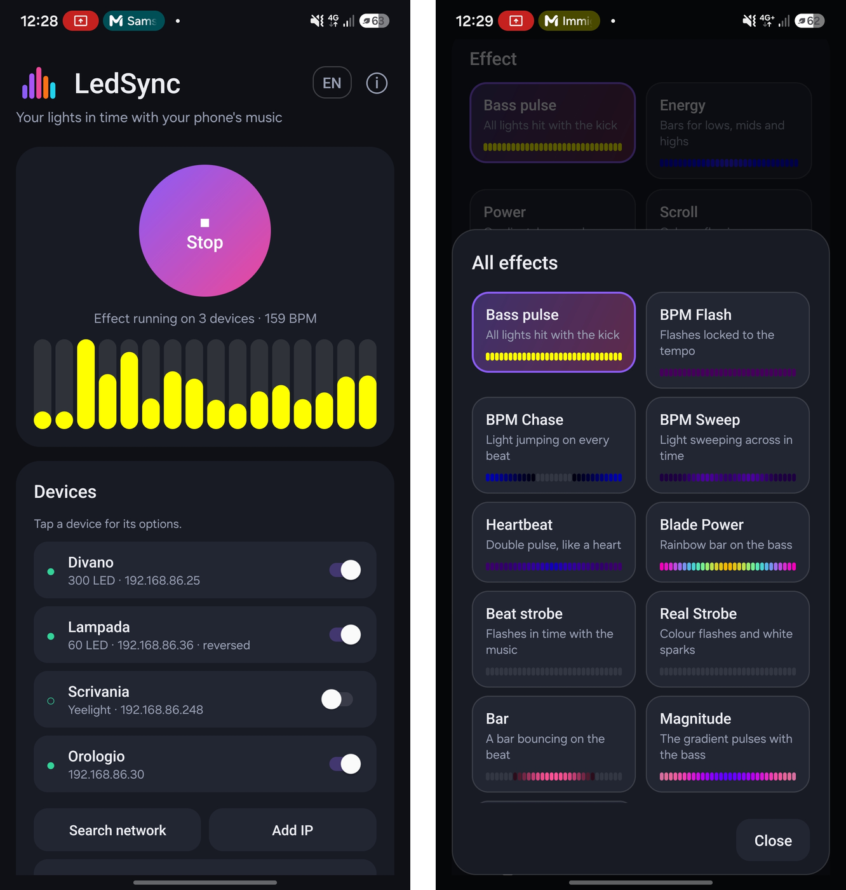

<p align="center">
  
</p>

<h1 align="center">LedSync</h1>

<p align="center">
  <b>Le tue luci a tempo con la musica del telefono.</b><br>
  Fa ballare le luci WLED, Yeelight, Govee e Philips Hue con Spotify, YouTube o qualsiasi app che suona sul tuo telefono Android.
</p>

<p align="center">
  <a href="https://github.com/IlGiurgi/LedSync/actions/workflows/build.yml"></a>
  <a href="LICENSE"></a>
  
  <a href="https://github.com/IlGiurgi/LedSync/releases"></a>
</p>

<p align="center">
  <a href="README.md">English</a> · <b>Italiano</b>
</p>

<p align="center">
  
</p>

---

## Perché LedSync
LedSync ascolta l'audio che il telefono sta già riproducendo, lo analizza sul telefono e manda lo spettacolo
di luci via Wi-Fi. **Niente microfono sulle luci, niente PC, niente server LedFx, niente cloud.**

## Funzioni

| | |
|---|---|
| 🎵 **36 effetti** | Pulsazione bassi, Energy, Scroll, Fuoco, Fuochi d'artificio, Meteore, Caleidoscopio, effetti BPM e altri, con anteprime animate. Molti sono adattati da [LedFx](https://github.com/LedFx/LedFx). Nel silenzio le luci si spengono, sui bassi colpiscono forte. |
| 🥁 **Rilevamento del tempo** | BPM mostrati mentre suona, effetti agganciati al battito, colori che cambiano a ogni battito. |
| 💡 **Tante luci insieme** | Ogni luce ha il suo numero di LED, effetto, luminosità, direzione e nome. |
| 🔠 **Griglie e orologi a parole** | Colonne dell'equalizzatore, e ogni altro effetto disegnato a cerchi dal centro. |
| 🎨 **Colori** | 9 gradienti, luminosità, specchio, sfocatura, rotazione colori, preferiti. |
| 🔁 **Senza mani** | Cambio automatico dell'effetto, spegnimento dopo il silenzio, comandi nella notifica, riquadro nelle Impostazioni rapide. |
| 🎤 **Modalità microfono** | Segue la musica di TV, PC o casse. |
| 🩺 **Diagnostica** | Fotogrammi al secondo, pause, ping e pacchetti persi per ogni luce. |
| 🔒 **Privacy** | Niente pubblicità, niente tracciamento, nessuna libreria Google, nessun accesso a Internet: solo la rete di casa. |

## Luci supportate

| Luce | Cosa preparare |
|---|---|
| **WLED** (strisce, lampade, matrici) | Niente: il realtime UDP è già attivo. |
| **ESPHome** | Aggiungi l'effetto `wled` alla luce e accendila con quell'effetto. |
| **Orologi a parole e altri firmware** | Qualsiasi dispositivo che accetta il realtime UDP di WLED (DNRGB, porta 21324). Imposta numero di LED e larghezza della griglia nelle opzioni della luce. |
| **Yeelight** strisce e lampadine | Attiva *Controllo LAN* nell'app Yeelight. |
| **Govee** | Attiva *LAN Control* nell'app Govee Home (non tutti i modelli lo hanno). |
| **Philips Hue** | Aggiungi il bridge e premi il suo pulsante quando richiesto. Ogni lampadina mostra un colore. |

## Per iniziare
1. Scarica l'APK da [Releases](https://github.com/IlGiurgi/LedSync/releases) e installalo (Android 10 o superiore).
2. Telefono e luci devono essere sulla stessa rete Wi-Fi.
3. Premi **Cerca in rete**, oppure **Aggiungi IP** se una luce non viene trovata.
4. Fai partire la musica e premi **Avvia**. Quando Android chiede cosa condividere, scegli **Schermo intero**: serve solo per l'audio, niente viene registrato o salvato.

Al primo avvio si apre una breve guida, che ritrovi sempre nel pulsante ⓘ.

### Consigli
- Non usare insieme un altro programma sulle stesse luci (per esempio un effetto di Home Assistant o LedFx).
- Su WLED attiva *Disable WiFi sleep* (Config → WiFi Setup) per una risposta più pronta.
- Imposta la batteria di LedSync su *Senza restrizioni*, così continua a schermo spento.
- Con casse Bluetooth usa *Ritardo luci* nelle regolazioni avanzate per allineare luci e suono.
- Alcune app (DRM o bancarie) bloccano la cattura dell'audio. Spotify, YouTube e la maggior parte dei lettori funzionano.

## Come funziona
Android permette a un'app di catturare l'audio delle altre app con `AudioPlaybackCapture`. Ogni 20 ms LedSync
calcola una FFT a 2048 punti, costruisce 32 bande di frequenza con bassi, medi e alti bilanciati in automatico,
segue il tempo, disegna l'effetto per ogni luce e lo invia:

- **WLED / ESPHome / orologi:** realtime UDP di WLED (DNRGB, porta 21324).
- **Yeelight:** modalità musica in LAN, con ripiego sui comandi normali.
- **Govee:** API LAN (UDP 4003). **Philips Hue:** API REST del bridge.
- **Modalità Sound Sync:** pacchetti WLED Audio Sync v2 (porta 11988), per usare gli effetti audio di WLED.

## Compilare
```
./gradlew assembleRelease
```
Java semplice, solo il framework Android (minSdk 29), nessuna libreria esterna.
`tools/build-without-sdk.sh` compila senza Gradle né SDK dove il Maven di Google non è raggiungibile, e
`tools/jvm-tests/` contiene i test desktop per l'analisi audio e gli effetti.

## Contribuire
Segnalazioni e idee sono benvenute nelle [Issues](https://github.com/IlGiurgi/LedSync/issues). Indica modello del telefono,
versione di Android e tipo di luci.

## Licenza
GPL-3.0-or-later, vedi [LICENSE](LICENSE). Diversi effetti sono adattati da LedFx (GPL-3.0), vedi [NOTICE.md](NOTICE.md).
Privacy: [PRIVACY.md](PRIVACY.md).

LedSync è un progetto indipendente, non affiliato a WLED, LedFx, Yeelight, Govee, Signify (Philips Hue) o ESPHome.
