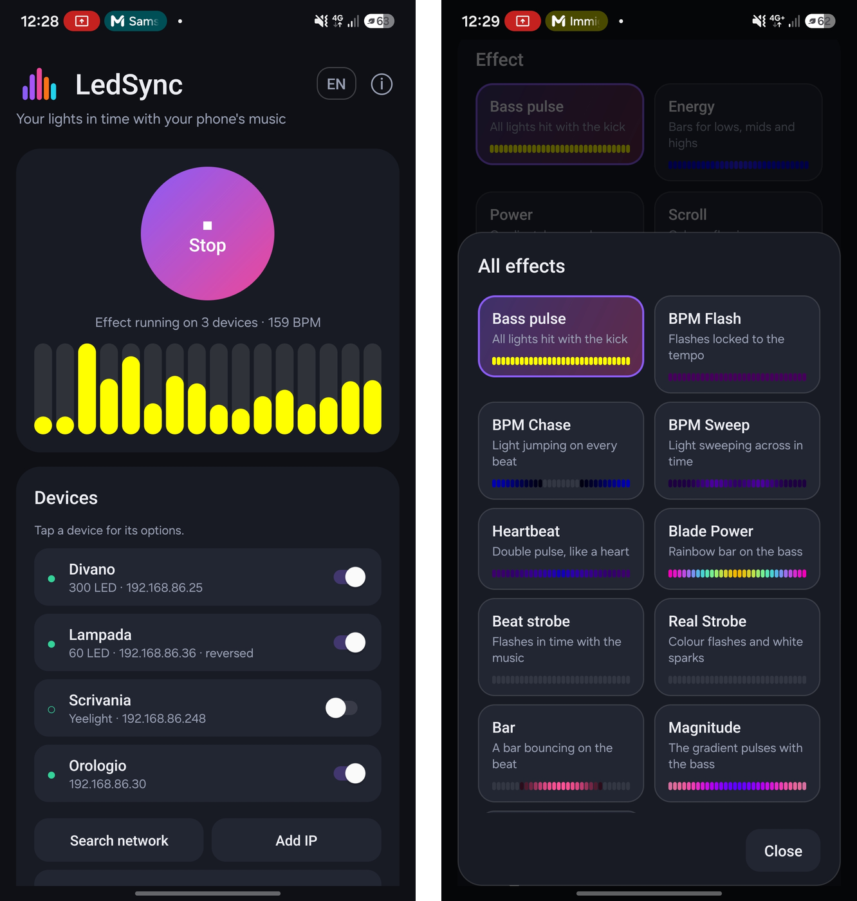

<p align="center">
  
</p>

<h1 align="center">LedSync</h1>

<p align="center">
  <b>Your lights in time with your phone's music.</b><br>
  Make WLED, Yeelight, Govee and Philips Hue lights dance to Spotify, YouTube or any app playing on your Android phone.
</p>

<p align="center">
  <a href="https://github.com/IlGiurgi/LedSync/actions/workflows/build.yml"></a>
  <a href="LICENSE"></a>
  
  <a href="https://github.com/IlGiurgi/LedSync/releases"></a>
</p>

<p align="center">
  <b>English</b> · <a href="README.it.md">Italiano</a>
</p>

<p align="center">
  
</p>

---

## Why LedSync
LedSync listens to the audio your phone is already playing, analyses it on the phone and streams the light
show to your lights over Wi-Fi. **No microphone on the lights, no PC, no LedFx server, no cloud.**

## Features

| | |
|---|---|
| 🎵 **36 effects** | Bass pulse, Energy, Scroll, Fire, Fireworks, Meteors, Kaleidoscope, BPM effects and more, with live previews. Many are adapted from [LedFx](https://github.com/LedFx/LedFx). The lights go dark in silence and hit hard on the bass. |
| 🥁 **Tempo detection** | BPM shown while running, effects locked to the beat, colours that change on every beat. |
| 💡 **Many lights at once** | Each light gets its own LED count, effect, brightness, direction and name. |
| 🔠 **Matrices and word clocks** | Equalizer columns, and every other effect drawn as rings from the centre. |
| 🎨 **Colours** | 9 gradients, brightness, mirror, blur, colour roll, favourites. |
| 🔁 **Hands-free** | Automatic effect change, automatic stop after silence, notification controls, Quick Settings tile. |
| 🎤 **Microphone mode** | Follow music from a TV, PC or speakers. |
| 🩺 **Diagnostics** | Frame rate, pauses, ping and packet loss for every light. |
| 🔒 **Private** | No ads, no tracking, no Google libraries, no internet: only your local network. |

## Supported lights

| Light | What to set up |
|---|---|
| **WLED** (strips, lamps, matrices) | Nothing: realtime UDP is on by default. |
| **ESPHome** | Add the `wled` effect to the light and turn it on with that effect. |
| **Word clocks and other firmware** | Any device that accepts WLED realtime UDP (DNRGB, port 21324). Set the LED count and grid width in the light's options. |
| **Yeelight** strips and bulbs | Turn on *LAN Control* in the Yeelight app. |
| **Govee** | Turn on *LAN Control* in the Govee Home app (not every model has it). |
| **Philips Hue** | Add the bridge and press its button when asked. Each bulb shows one colour. |

## Getting started
1. Download the APK from [Releases](https://github.com/IlGiurgi/LedSync/releases) and install it (Android 10 or newer).
2. Make sure the phone and the lights are on the same Wi-Fi network.
3. Tap **Search network**, or **Add IP** if a light is not found.
4. Play some music and tap **Start**. When Android asks what to share, choose **Entire screen**: it is only used for the audio, nothing is recorded or saved.

A short guide opens on first launch, and is always available from the ⓘ button.

### Tips
- Don't run another program on the same lights at the same time (for example a Home Assistant effect or LedFx).
- On WLED, enable *Disable WiFi sleep* (Config → WiFi Setup) for a faster response.
- Set LedSync's battery usage to *Unrestricted* so it keeps running with the screen off.
- With Bluetooth speakers, use *Light delay* in the advanced settings to line the lights up with the sound.
- Some apps (DRM or banking) block audio capture. Spotify, YouTube and most players work.

## How it works
Android lets an app capture other apps' audio with `AudioPlaybackCapture`. Every 20 ms LedSync runs a
2048-point FFT, builds a 32-band log-frequency melbank with auto-balanced lows, mids and highs, tracks the
tempo, renders the effect for each light and sends it:

- **WLED / ESPHome / clocks:** WLED realtime UDP (DNRGB, port 21324).
- **Yeelight:** LAN music mode, with a fallback to normal commands.
- **Govee:** LAN API (UDP 4003). **Philips Hue:** bridge REST API.
- **Sound Sync mode:** WLED Audio Sync v2 packets (port 11988), to use WLED's own audio-reactive effects.

## Build
```
./gradlew assembleRelease
```
Plain Java on the Android framework only (minSdk 29), no third-party libraries.
`tools/build-without-sdk.sh` builds without Gradle or the SDK where Google's Maven is not reachable, and
`tools/jvm-tests/` holds desktop tests for the audio analysis and the effects.

## Contributing
Bug reports and ideas are welcome in [Issues](https://github.com/IlGiurgi/LedSync/issues). Please include your phone model,
Android version and the kind of lights you use.

## License
GPL-3.0-or-later, see [LICENSE](LICENSE). Several effects are adapted from LedFx (GPL-3.0), see [NOTICE.md](NOTICE.md).
Privacy policy: [PRIVACY.md](PRIVACY.md).

LedSync is an independent project and is not affiliated with WLED, LedFx, Yeelight, Govee, Signify (Philips Hue) or ESPHome.
